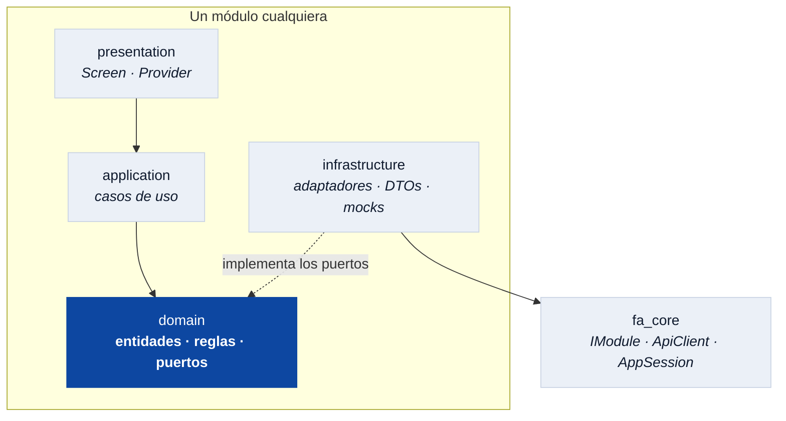

# fa_core

El contrato. Lo único que todos los módulos importan y lo único que ninguno
puede evitar.

`fa_core` no tiene pantallas ni lógica de negocio: define **cómo se enchufa un
módulo al shell** y qué puede darse por hecho de la app que lo hospeda. Si algo
de aquí cambia, cambia para los diez paquetes a la vez, así que crece despacio y
a propósito.

## Qué hay dentro

| Pieza | Para qué |
|---|---|
| `IModule` | El contrato de un módulo: rutas, providers, tabs, tarjeta del home. |
| `HomeTab` | Los tabs de primer nivel que un módulo puede reclamar. |
| `NavigationCallbacks` | Los saltos que el módulo pide y el shell resuelve. |
| `ApiClient` | El cliente HTTP con su cadena de interceptores. |
| `AppConfig` | Flavor y `baseUrl`. Se configura una vez, en el `main`. |
| `AppSession` | Los pocos hechos que dos módulos que no se importan necesitan compartir. |
| `SafeNotifier` | Un `ChangeNotifier` que deja de avisar al destruirse. |
| `comoNombrePropio` | Baja las mayúsculas de la INE al mostrar un nombre. |

## El hexágono que hace posible todo esto

`fa_core` es el borde común de nueve hexágonos. Cada módulo tiene su dominio en
el centro —entidades y reglas, sin importar nada— y declara **puertos**:
interfaces que la infraestructura implementa. La dependencia queda invertida, y
por eso el mismo módulo funciona contra el BFF o contra un interceptor en
memoria sin que su negocio se entere.



La regla de oro es la dirección de las flechas: **hacia el centro**. Si un día
`domain/` necesita importar algo de `infrastructure/`, el diseño se rompió — y
se nota, porque el import no existe.

## Las dos decisiones que explican el resto

**El shell no conoce a nadie.** `IModule` es la única forma de aparecer en la
app. Un módulo declara sus rutas (`List<RouteBase>`), sus providers y, si quiere
estar en el home, su tarjeta y su prelación:

```dart
class CreditModule implements IModule {
  @override String get moduleId => 'fa_credit';
  @override List<RouteBase> get routes => [ /* … */ ];
  @override int get homeCardOrder => 20;   // menor va primero
  @override Widget? buildHomeCard(BuildContext context) => /* … */;
}
```

Nadie escribe `import 'package:fa_credit/...'` fuera de `fa_credit`. Ni el
shell. Por eso se puede sacar un módulo del `ShellInjection` y la app sigue
compilando, sin la funcionalidad pero entera.

**`AppSession` existe porque hay hechos de nadie.** El propósito del crédito, el
`prospectId`, si el titular ya tiene línea de colocación: son datos que el alta
produce y que crédito y colocación consumen, sin que ninguno de los tres pueda
importar a los otros. Vive en memoria y sólo durante la sesión — persistirlo o
resolverlo desde `/me` queda pendiente.

## Lo que NO va aquí

Widgets (van en `fa_design_system`), reglas de negocio de un dominio (van en su
módulo) y cualquier cosa que sólo use un paquete. La prueba es simple: si sólo
lo necesita uno, no es del core.
