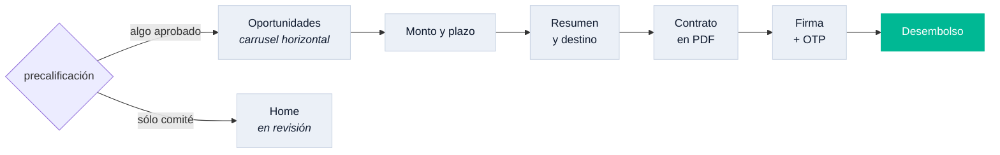

# fa_credit

Del catálogo de productos al desembolso, y después la vida del crédito: pagos,
disposiciones y mora. 47 archivos y 8 suites de prueba — el módulo con más
reglas del monorepo.

| | |
|---|---|
| Rutas | `/credit`, `/credit/list`, `/credit/after-analysis` y 11 bajo `/credit/apply/*` |
| Tabs | ninguno |
| Tarjeta del home | sí — `homeCardOrder = 20` |
| Depende de | `fa_core`, `fa_design_system`, `fa_wallet` |

## El recorrido



La precalificación decide qué se ofrece. Si nada quedó aprobado pero hay
productos en comité, se lleva al home **diciendo en qué va**, en vez de a un
catálogo vacío.

## La tarjeta del home

Va **debajo** de la línea de distribuidor (`homeCardOrder = 20`) porque el orden
del home es de prelación, no estético: primero el dinero del que el titular
responde, después el que tomó para sí, al final lo que se le ofrece.

Dos reglas que costaron encontrar:

- **La línea de distribuidor se excluye de esta tarjeta**, pero sólo ella: la
  pinta `fa_placements` con su propio vocabulario. Repetirla aquí daría dos
  tarjetas del mismo dinero contándolo distinto.
- **Un crédito y varios usan la misma tarjeta.** El diseño no tiene una versión
  "suelta": sólo cambia el ancho (250 en carrusel, 100 % si está sola). Y el
  encabezado `MIS CRÉDITOS` va siempre que haya al menos uno.

## Mocks con reloj

Los interceptores no devuelven JSON fijo: simulan **el paso del tiempo**. El
devengo diario mueve el saldo, el vencimiento se recorre con cada pago y la mora
aparece sola. Eso permite probar el ciclo completo sin esperar en tiempo real, y
es lo que cubren `mock_delinquency_test` y `credit_mock_preoffer_test`.

## Cómo está construido

Arquitectura hexagonal, como todos los módulos: el dominio en el centro sin
importar nada, los casos de uso alrededor, y los adaptadores —HTTP, mocks,
DTOs— en el borde implementando los puertos que el dominio declara. El diagrama
y la regla de las flechas están en
[`fa_core`](../fa_core/README.md#el-hexágono-que-hace-posible-todo-esto).

```
lib/src/
├── domain/          entidades, reglas y puertos
├── application/     casos de uso
├── infrastructure/  adaptadores, DTOs y el mock del módulo
└── presentation/    providers y pantallas
```
