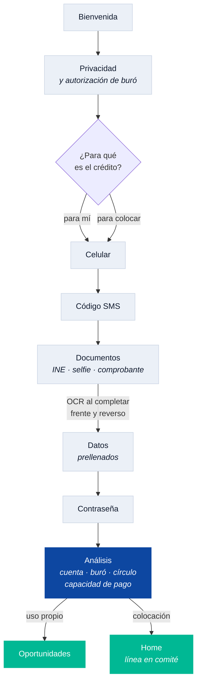

# fa_onboarding

El alta: de una pantalla de bienvenida a una persona con cuenta, expediente y
consulta de buró autorizada. 32 archivos, el módulo más largo del recorrido.

| | |
|---|---|
| Rutas | `/onboarding` y 11 más (`welcome`, `privacy`, `purpose`, `phone`, `otp`, `identity`, `password`, `analysis`, `success`…) |
| Tabs | ninguno |
| Tarjeta del home | ninguna |
| Depende de | `fa_core`, `fa_design_system` |



## El orden importa

1. **Bienvenida** → **privacidad**. El alta abre pidiendo permiso: nada se pide
   antes de tener autorización para pedirlo.
2. **Propósito** — para mí o para colocar. Bifurca todo lo que sigue: qué
   productos se evalúan, a dónde se llega tras el análisis y en qué se enfoca el
   home. Se publica en `AppSession.purpose`.
3. **Celular + OTP**. El código llega pegado a la captura, no antes.
4. **Documentos y datos** — una sola pantalla con control segmentado. El OCR del
   INE se dispara al completar frente y reverso, y **prellena** la pestaña de
   datos. El orden es Documentos → Datos a propósito: pedir que teclee lo que la
   foto ya dice es trabajo que la app puede ahorrarle.
5. **Contraseña** → dispara el **análisis** (crear cuenta, buró, círculo,
   capacidad de pago) y de ahí sale a las oportunidades o al home.

## Detalles que cuestan si se ignoran

- El anillo del análisis gira en bucle: en tests **nunca** `pumpAndSettle` ahí.
- La CURP debe cumplir `[A-Z]{4}\d{6}[HM][A-Z]{5}[A-Z0-9]\d`. Un dígito entre
  las cinco letras da un 400 que en pantalla se ve como "Intentar de nuevo", sin
  decir que el problema fue la CURP.
- Tras registrar, el primer login puede llegar antes que la credencial: identity
  la crea por Kafka. `kyc_repository_impl` reintenta con espera creciente.

## Cómo está construido

Arquitectura hexagonal, como todos los módulos: el dominio en el centro sin
importar nada, los casos de uso alrededor, y los adaptadores —HTTP, mocks,
DTOs— en el borde implementando los puertos que el dominio declara. El diagrama
y la regla de las flechas están en
[`fa_core`](../fa_core/README.md#el-hexágono-que-hace-posible-todo-esto).

```
lib/src/
├── domain/          entidades, reglas y puertos
├── application/     casos de uso
├── infrastructure/  adaptadores, DTOs y el mock del módulo
└── presentation/    providers y pantallas
```
