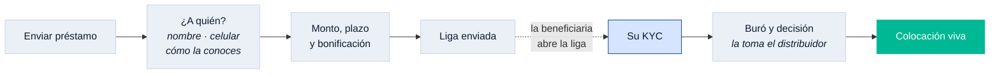

# fa_placements

Colocación B2B2C: un distribuidor presta **su** línea a un tercero. La deuda
sigue siendo del distribuidor; el crédito y el contrato quedan a nombre de la
persona que recibe.

| | |
|---|---|
| Rutas | `/placements/new`, `/placements/new/amount`, `/placements/sent`, `/placements/:id/bureau` |
| Tabs | `HomeTab.colocaciones`, `HomeTab.beneficiarios` |
| Tarjeta del home | sí — `homeCardOrder = 10`, la primera |
| Depende de | `fa_core`, `fa_design_system` |

## Por qué va primero en el home

La línea de colocación es el dinero del que el distribuidor **responde frente a
Kredius**, y de ella cuelga todo lo demás que hace en la app. Quien abre y ve
primero una promoción y hasta abajo su línea no está viendo su situación: está
viendo un catálogo.

## El flujo



Los pasos en azul claro los hace **otra persona**, en su propio teléfono: por eso
la liga y no un formulario más del distribuidor. Los estados viven en `PlacementStatus`
(10 valores, incluido `failed`) y la bonificación sale de una tabla de comisión
decreciente `[0.20, 0.17, 0.14, 0.10, 0.06]`.

## Tabs condicionales

`areTabsVisible` devuelve `false` mientras no haya línea: un tab que sólo puede
enseñar un vacío es peor que no estar. Los dos tabs aparecen juntos cuando la
línea se aprueba — **la operación** (Colocaciones) y **el directorio**
(Beneficiarios) del mismo dominio.

El contrato de API está congelado en `docs/KREDIUS_COLOCACION_API.md`.

## Cómo está construido

Arquitectura hexagonal, como todos los módulos: el dominio en el centro sin
importar nada, los casos de uso alrededor, y los adaptadores —HTTP, mocks,
DTOs— en el borde implementando los puertos que el dominio declara. El diagrama
y la regla de las flechas están en
[`fa_core`](../fa_core/README.md#el-hexágono-que-hace-posible-todo-esto).

```
lib/src/
├── domain/          entidades, reglas y puertos
├── application/     casos de uso
├── infrastructure/  adaptadores, DTOs y el mock del módulo
└── presentation/    providers y pantallas
```
